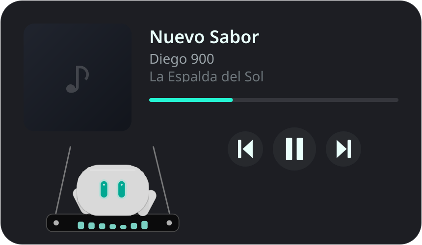

# Floatbeat

> A tiny DJ living in your GNOME top bar.

**Status: v0.2.0-alpha.2 — extension + engine + popover.** The bar avatar reacts
to playback, goes idle when nothing is playing, and clicking it opens the
translucent mixer with the track, the cover and the controls.



Floatbeat started as a floating window (v0.1.0) and pivoted to a GNOME Shell
extension: a window that is always visible *without covering window titles* can
only live in space the desktop already reserves — the panel. The full story is
in [`docs/DECISIONS.md`](docs/DECISIONS.md) (ADR-015).

## What works

- A 56×38 actor in the top panel, left of the clock, drawn with Cairo. It
  overflows 6 px below the bar so the mixer desk dangles from the edge.
- **Idle**: grey eyes, no equaliser, no animation, timer stopped.
- **Playing**: cyan glowing eyes, equaliser bars and arms that lean with the beat.
- **Click**: a 430×250 translucent popover with the big avatar, album art,
  title/artist/album, progress and play/pause/previous/next.
- The Python engine reads MPRIS2 (Spotify, VLC, browsers, mpv…) and publishes
  `Frame(playing, {level, bands})` over D-Bus. Levels are synthetic until the
  real `parec` capture lands.


## Install

### 1. Extension

```bash
./extension/install.sh
# GNOME only scans extensions at login:
# log out and back in
gnome-extensions enable floatbeat@rarroy2.github.io
```

### 2. Engine

```bash
uv pip install -e .
.venv/bin/floatbeat-engine
```

The engine is optional for the bar to exist: without it the character stays
idle. With it, it follows whatever MPRIS reports.

For development without Spotify:

```bash
.venv/bin/floatbeat-engine --demo
```

To disable the extension:

```bash
gnome-extensions disable floatbeat@rarroy2.github.io
```

## Requirements

- GNOME Shell 45–50 (tested on 50.6, Wayland).
- Python 3.12+ and PySide6 for the engine and the popover.
- A session bus with at least one MPRIS player for the playing state.

## Project layout

```
floatbeat/
├── extension/            # GNOME Shell extension (GJS + Cairo)
│   ├── extension.js      # panel placement, D-Bus client, timer, click
│   ├── avatar.js         # mini avatar drawing (56×38 design space)
│   └── install.sh
├── src/floatbeat/
│   ├── engine.py         # MPRIS + D-Bus service + frame loop + popover
│   ├── audio/            # MPRIS client, RMS/bands, synthetic source
│   ├── ui/blob.py        # avatar for the popover
│   ├── ui/popover.py     # translucent mixer
│   └── desktop/          # XWayland preference and screen helpers
├── tools/preview.py      # render the popover avatar to PNG
├── tests/                # 29 tests
└── docs/
```

The original floating-window app lives in the `v0.1.0` tag: it proved the
rendering budget (1.33 ms/frame, 6.4 % of one core) and the reasons why a normal
window cannot satisfy the requirement.

## Performance

Measured on this machine (12 threads, GNOME 50.6 on Wayland, PySide6 6.12):

| Piece | Cost |
| --- | --- |
| Extension, idle | No animation timer; one repaint on state change |
| Extension, playing | 56×38 Cairo surface at 25 fps |
| Engine, idle | 0.50 % of one core, ~59 MB RSS (offscreen; ~85 MB with the X11 plugin) |
| Engine, playing | 2.17 % of one core, ~59 MB RSS |
| Popover | Only painted while open, 25 fps in its avatar area |

The engine keeps a `QApplication` alive for the popover, which is where the RAM
goes. Splitting it into a light `QCoreApplication` service plus a transient
popover process is a possible optimisation if it matters.

## Why the pivot

- A normal window cannot sit inside the GNOME bar: the shell draws the panel above
  every client.
- Any window just below the bar covers the title bar of maximised windows.
- The only space that is always visible and reserved is the panel, and the panel
  is 32 px tall.

So the character lives in the panel at bar scale, and the full-size version moves
into a popover. Details, measurements and rejected alternatives:
[`docs/DECISIONS.md`](docs/DECISIONS.md) ADR-015.

## License

Code under the [MIT License](LICENSE). Artwork, when it exists, will be released
under its own license file.
